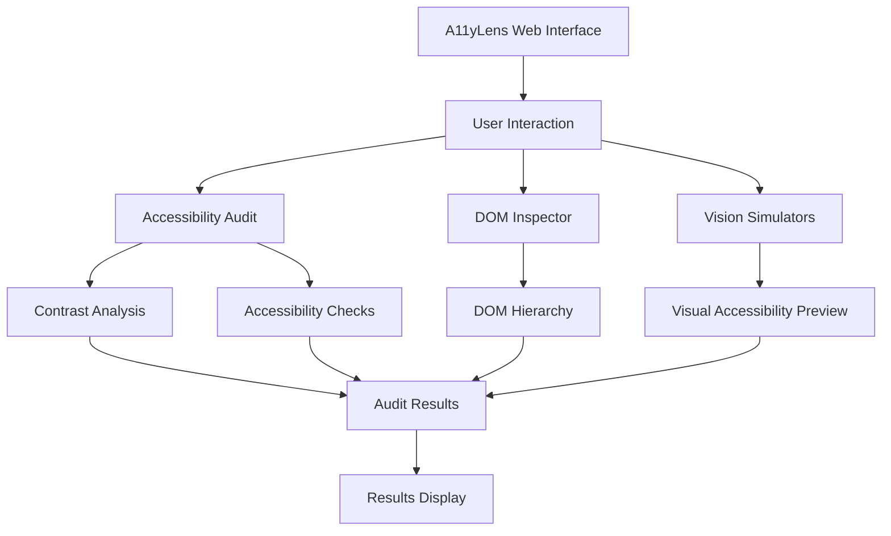

 

# 👨‍💻 SHIKHAR JOSHI

### Full Stack Developer | AI/ML Enthusiast | Technology Explorer

*Building useful software applications*

---

## 👋 01. About Me

Hello! I'm **Shikhar Joshi**, a Computer Science student specializing in Artificial Intelligence and Machine Learning.

I'm passionate about building practical software applications, exploring intelligent technologies, and creating meaningful digital experiences.

- 🎓 B.Tech CSE (AI & ML) — Shri Ramswaroop Memorial University
- 💻 Interested in Full Stack Development
- 🤖 Exploring Artificial Intelligence and Machine Learning
- 🚀 Interested in Web Accessibility and Inclusive Design
- 🧠 Learning backend development and database integration
- 🎯 Focused on building practical projects and improving my skills

> My philosophy: Learn continuously, build purposefully, and solve real-world problems through technology.

---

## 🛠️ 02. Technology Stack

### Programming Languages

### Frontend Development

### Backend & Frameworks

### Database Technologies

### AI & Machine Learning

### Developer Tools

---

## 🚀 03. Featured Project

### A11yLens

**Interactive Accessibility Audit & DOM Hierarchy Inspector**

A11yLens is an interactive web accessibility auditing tool designed to help developers understand website accessibility, inspect DOM structures, and identify potential usability barriers.

### ✨ Key Features

| Feature | Description |
|---|---|
| 🎨 Contrast Engine | Analyze foreground and background color contrast |
| 🌳 DOM Inspector | Explore website DOM hierarchy |
| 🔊 ARIA Live Announcer | Demonstrate accessible announcements |
| 👁️ Vision Simulators | Explore visual accessibility scenarios |
| ♿ Accessibility Checks | Evaluate selected accessibility criteria |
| 🧩 Template Chips | Preview accessibility-related examples |
| 📊 Audit Interface | Explore accessibility audit information |

### 🧰 Built With

### 🔗 Explore A11yLens

---

## 🖼️ 04. Project Screenshots

Explore the A11yLens interface and its features through the live project:

- [Main Dashboard — Open Live Demo](https://shikharjoshi72-droid.github.io/Personal-project--A11yLens-/)
- [Accessibility Contrast Engine — Open Live Demo](https://shikharjoshi72-droid.github.io/Personal-project--A11yLens-/)
- [DOM Hierarchy Inspector — Open Live Demo](https://shikharjoshi72-droid.github.io/Personal-project--A11yLens-/)

*Screenshots will be added here when the actual image files are uploaded to the repository.*

**🚧 Project Status: Currently Under Development**

A11yLens is actively being developed, with improvements and new accessibility features planned for future updates.
---

## 🏗️ 05. Project Architecture

The following diagram illustrates the high-level organization of the A11yLens interface and its accessibility features.

### Architecture Overview

- User interacts with the web interface.
- Accessibility modules provide different inspection and simulation features.
- Results are presented through the interface.
- The tool helps developers explore accessibility-related improvements.

---

## 📚 06. Current Learning Journey

| Domain | Focus |
|---|---|
| Full Stack Development | Responsive interfaces and application development |
| Backend Engineering | APIs and server-side programming |
| Artificial Intelligence | AI-powered applications and LLMs |
| Machine Learning | Model integration and experimentation |
| Database Management | SQL and data organization |
| Cloud & DevOps | Deployment and development workflows |
| Accessibility | WCAG and inclusive web experiences |

---

## 📊 07. GitHub Analytics

---

## 🐍 08. Contribution Activity

*Contribution snake animation requires a configured GitHub Actions workflow in your profile repository.*

---

## 🌱 09. Beyond Coding

| Principle | My Approach |
|---|---|
| 🚀 Innovation | Turn ideas into practical applications |
| 📚 Learning | Continuously explore new technologies |
| 🧩 Problem Solving | Understand problems before building solutions |
| 🤝 Collaboration | Learn and grow with other developers |
| ♿ Accessibility | Build experiences that are usable by everyone |

---

## 🤝 10. Let's Connect

I'm interested in connecting with developers, collaborating on projects, learning from experienced professionals, and exploring opportunities in software development and AI.

### ⚡ Think. Build. Learn. Repeat.

